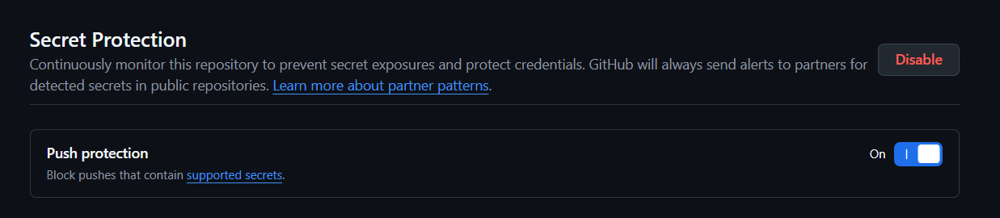

# DevSecOps TP

## 1. Secrets

### Protections GitHub

Les protections suivantes sont activées sur le dépôt :

- Secret Protection : activé.
- Push Protection : activé.

Capture d'écran :

### Gestion des secrets

Le fichier `.gitignore` exclut les éléments suivants :

- `node_modules/`
- `.env`
- `coverage/`
- `*.log`

Le fichier `.env.example` fournit un exemple de configuration sans aucune donnée sensible.

### Question : une clé AWS publiée sur GitHub

Un collègue a publié une véritable clé AWS il y a trois jours, puis l'a supprimée dans un nouveau commit.

Cette clé doit être considérée comme compromise, même si elle n'apparaît plus dans la dernière version du code.

En effet, Git conserve l'historique des commits. La clé reste donc potentiellement accessible dans les anciens commits, les forks ou les clones du dépôt.

Les actions à effectuer, dans l'ordre :

1. Révoquer immédiatement la clé AWS compromise dans IAM.
2. Générer une nouvelle clé si elle est encore nécessaire et mettre à jour les applications qui l'utilisent.
3. Examiner les journaux AWS CloudTrail pour rechercher une éventuelle utilisation frauduleuse.
4. Supprimer la clé de l'historique Git avec un outil adapté, puis coordonner le nettoyage des branches et des copies concernées.
5. Vérifier qu'aucun autre secret n'a été exposé et contrôler les alertes Secret Scanning.

**Conclusion : une clé publiée se révoque, elle ne se supprime pas simplement du code.**

## 2. Dependances

### Tableau d'audit

| État | Critique | Haute | Modérée | Faible | Total |
| --- | --- | --- | --- | --- | --- |
| Avant | 0 | 5 | 16  | 7 | 28 |
| Après | 0 | 0 | 16 | 4 | 20 |