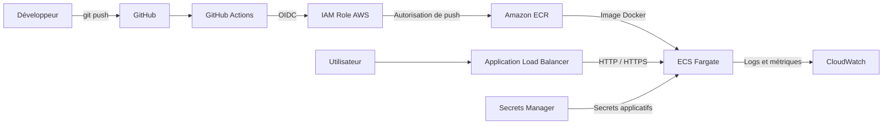

# DevSecOps TP

## 1. Secrets

### Protections GitHub

Les protections suivantes sont activées sur le dépôt :

- **Secret Protection** : activé.
- **Push Protection** : activé.

Capture d'écran : `docs/secrets-settings.png`


### Gestion des secrets

Le fichier `.gitignore` exclut les éléments suivants :

- `node_modules/`
- `.env`
- `coverage/`
- `*.log`

Le fichier `.env.example` fournit un exemple de configuration sans aucune donnée sensible.

Aucun secret ne doit être ajouté au dépôt Git. Les variables sensibles doivent être injectées au moment de l'exécution à partir d'un gestionnaire de secrets.

### Question : une clé AWS publiée sur GitHub

Un collègue a publié une véritable clé AWS il y a trois jours, puis l'a supprimée dans un nouveau commit.

Cette clé doit être considérée comme compromise, même si elle n'apparaît plus dans la dernière version du code.

Git conserve l'historique des commits. La clé reste donc potentiellement accessible dans les anciens commits, les forks ou les clones du dépôt.

Les actions à effectuer, dans l'ordre :

1. Révoquer immédiatement la clé AWS compromise dans IAM.
2. Générer une nouvelle clé uniquement si elle est encore nécessaire et mettre à jour les applications qui l'utilisent.
3. Examiner les journaux AWS CloudTrail pour rechercher une éventuelle utilisation frauduleuse.
4. Supprimer la clé de l'historique Git avec un outil adapté, puis coordonner le nettoyage des branches et des copies concernées.
5. Vérifier qu'aucun autre secret n'a été exposé et contrôler les alertes Secret Scanning.

**Conclusion : une clé publiée se révoque, elle ne se supprime pas simplement du code.**

---

## 2. Dépendances

### Audit npm : avant et après corrections

L'audit initial a révélé 28 vulnérabilités. Les dépendances ont ensuite été mises à jour pour réduire le nombre de vulnérabilités détectées.

| État | Critique | Haute | Modérée | Faible | Total |
|---|---:|---:|---:|---:|---:|
| Avant corrections | 0 | 5 | 16 | 7 | 28 |
| Après corrections | 0 | 0 | 16 | 4 | 20 |

Les principales dépendances mises à jour sont :

| Dépendance | Version |
|---|---:|
| Express | `4.22.3` |
| Lodash | `4.18.1` |
| Jest | `29.7.0` |
| Express Rate Limit | `8.7.3` |

Le workflow CI utilise :

```bash
npm audit --audit-level=high
```

Cette commande fait échouer le pipeline lorsqu'une vulnérabilité de niveau élevé ou critique est détectée.

**Résultat :** les vulnérabilités de niveau élevé et critique ont été éliminées. Les vulnérabilités modérées et faibles restantes doivent néanmoins être surveillées, notamment celles provenant de dépendances transitives.

---

## 5. Dockerfile

### Optimisation et sécurisation de l'image

L'image Docker initiale était volumineuse et contenait des éléments qui n'étaient pas nécessaires à l'exécution de l'application.

L'image optimisée utilise :

- Une image de base Alpine.
- Une construction multi-stage.
- `npm ci --omit=dev` pour installer uniquement les dépendances de production.
- Un utilisateur non privilégié (`node`).
- Une copie limitée aux fichiers nécessaires à l'exécution.
- Une mise à jour de npm pour corriger les vulnérabilités identifiées dans l'outil fourni avec l'image de base.

### Analyse du Dockerfile initial

| Question | Réponse |
|---|---|
| Couche la plus lourde | Installation système Debian, environ 619 MB |
| `.env` présent dans le contexte de build ? | Oui, s'il existe et n'est pas exclu par `.dockerignore` |
| `.git` présent dans le contexte de build ? | Oui, s'il existe et n'est pas exclu par `.dockerignore` |

Pour éviter d'envoyer des fichiers inutiles au moteur Docker, un fichier `.dockerignore` peut notamment exclure :

```dockerignore
node_modules
.git
.env
.env.*
coverage
*.log
```

La présence d'un fichier dans le contexte de build ne signifie pas qu'il sera nécessairement présent dans l'image finale : cela dépend des instructions `COPY` du Dockerfile.

---

# Sécurité & coûts

## 1. État des workflows GitHub Actions

Les workflows automatisent les tests, les audits de dépendances et l'analyse de sécurité.


- **CI** : exécution des tests Jest, audit des dépendances et analyse de l'image Docker.
- **CodeQL** : analyse statique du code JavaScript pour détecter les vulnérabilités.

Les workflows sont exécutés lors des modifications de la branche principale et des Pull Requests.

## 2. Audit des dépendances npm

Le tableau ci-dessous présente l'évolution de l'audit des dépendances après les corrections.

| État | Critique | Haute | Modérée | Faible | Total |
|---|---:|---:|---:|---:|---:|
| Avant corrections | 0 | 5 | 16 | 7 | 28 |
| Après corrections | 0 | 0 | 16 | 4 | 20 |

Le job `deps-audit` exécute `npm audit --audit-level=high`.

Les vulnérabilités de niveau élevé et critique ne sont plus détectées par cet audit. Les vulnérabilités de niveau modéré et faible restent à surveiller.

## 3. Analyse des vulnérabilités du code

Trois failles ont été identifiées et traitées dans l'application.

| Route | Vulnérabilité | Exemple d'attaque | Correction |
|---|---|---|---|
| `/hello` | Cross-Site Scripting (XSS) réfléchi | Injection d'une balise HTML ou JavaScript dans le paramètre utilisateur | Échappement HTML des données utilisateur avec `escapeHtml` |
| `/ping` | Injection de commande | Tentative d'injection de commandes système dans le paramètre `host` | Validation stricte du nom d'hôte et utilisation de `execFile` avec des arguments séparés |
| `/prefs` | Prototype Pollution | Tentative de modification du prototype via `__proto__` | Liste blanche des propriétés autorisées : `theme` et `lang` |

Des tests de régression ont été ajoutés dans `tests/security.test.js` pour vérifier que ces vulnérabilités ne réapparaissent pas.

**Résultat des tests :** 2 suites de tests réussies et 5 tests validés.

Les protections applicatives incluent également une limitation du nombre de requêtes sur la route `/ping`.

## 4. Comparaison des images Docker

L'image initiale utilisait une configuration plus lourde et contenait des composants vulnérables dans l'environnement npm global.

L'image sécurisée utilise une construction multi-stage et une base Alpine, limite les dépendances installées et exécute l'application avec un utilisateur non privilégié.

| Critère | Image initiale | Image sécurisée |
|---|---:|---:|
| Tag | `naif` | `secure` |
| Taille affichée par Docker | 1,71 Go | 318 Mo |
| Vulnérabilités HIGH détectées par Trivy | 10 | 0 |
| Vulnérabilités CRITICAL détectées par Trivy | 0 | 0 |
| Résultat du scan | Vulnérabilités détectées | Aucune vulnérabilité détectée |

Le premier scan Trivy a notamment identifié des vulnérabilités dans des dépendances de l'installation npm globale de l'image.

Après mise à jour de npm et reconstruction de l'image, le dernier rapport Trivy disponible indique zéro vulnérabilité dans les composants analysés.

L'image finale ne copie que les fichiers nécessaires à l'exécution de l'API et utilise un utilisateur non-root.

## 5. Architecture AWS cible

L'architecture cible utilise GitHub Actions pour automatiser la construction et le déploiement de l'application sur AWS.



OIDC permet à GitHub Actions d'obtenir des identifiants AWS temporaires sans stocker de clés d'accès AWS permanentes dans les secrets GitHub.

Amazon ECR conserve les images Docker. ECS Fargate exécute l'application sans nécessiter de gestion directe des serveurs.

Secrets Manager permet de fournir les secrets applicatifs, tandis que CloudWatch centralise les journaux et les métriques.

**Important : cette architecture est une cible théorique. Aucune ressource AWS n'a été créée dans le cadre de ce TP.**

## 6. Estimation des coûts AWS

Configuration étudiée : une tâche ECS Fargate avec 0,25 vCPU et 0,5 Go de mémoire, dans la région `us-east-1`.

Prix utilisés :

- x86 : 0,04048 $ / vCPU-h et 0,004445 $ / Go-h.
- ARM : 0,03238 $ / vCPU-h et 0,003556 $ / Go-h.

| Scénario | Heures / mois | Calcul | Coût / mois |
|---|---:|---|---:|
| A. x86, 24h/24 | 730 | 730 × (0,25 × 0,04048 + 0,5 × 0,004445) | **9,01 $** |
| B. ARM, 24h/24 | 730 | 730 × (0,25 × 0,03238 + 0,5 × 0,003556) | **7,21 $** |
| C. x86, 12h × 5j | 260 | 260 × (0,25 × 0,04048 + 0,5 × 0,004445) | **3,21 $** |

Le scénario C utilise une estimation de 260 heures mensuelles : 12 heures par jour, 5 jours par semaine, sur une moyenne de 4,33 semaines par mois.

### Coût de la NAT Gateway

Une NAT Gateway coûte 0,045 $ par heure.

Calcul mensuel :

```text
730 × 0,045 = 32,85 $ / mois
```

Comparaison :

- Tâche ECS Fargate x86 : 9,01 $ / mois.
- NAT Gateway : 32,85 $ / mois.

La NAT Gateway coûte environ 3,65 fois plus cher que la tâche Fargate x86.

**Conclusion :** le coût fixe de la NAT Gateway est important, même sans trafic. Son coût dépasse celui de notre tâche Fargate. Il faut donc anticiper les coûts réseau et étudier les besoins de connectivité avant de construire l'infrastructure.

## 7. Réponses aux questions « À vous »

### Question 1 – Une clé AWS a été publiée sur GitHub

Supprimer la clé dans un nouveau commit ne suffit pas : elle reste potentiellement accessible dans l'historique Git et a pu être récupérée par un tiers.

Les actions à réaliser sont :

1. Révoquer immédiatement la clé AWS compromise.
2. Générer une nouvelle clé uniquement si elle est nécessaire.
3. Examiner les journaux CloudTrail pour détecter une éventuelle utilisation frauduleuse.
4. Nettoyer l'historique Git et les copies concernées.
5. Vérifier qu'aucun autre secret n'a été exposé.

**Conclusion :** une clé publiée doit être considérée comme compromise et révoquée immédiatement.

### Question 2 – Incident de sécurité Trivy de mars 2026

Le 19 mars 2026, un attaquant a exploité des identifiants compromis pour publier une version malveillante de Trivy et modifier 76 des 77 tags de version de `aquasecurity/trivy-action`.

Le code malveillant pouvait récupérer des secrets et des identifiants présents dans les environnements GitHub Actions.

Cet incident montre qu'une référence à un simple tag de version n'est pas une garantie d'intégrité : un tag peut être modifié après sa publication.

La bonne pratique consiste à :

- Épingler les GitHub Actions tierces sur un SHA complet de commit.
- Vérifier que ce SHA correspond bien à un commit légitime et sûr.
- Mettre à jour les références uniquement après vérification.
- Limiter les permissions accordées aux workflows.
- Contrôler les secrets accessibles pendant l'exécution.

Dans ce projet, l'action Trivy est référencée par un SHA de commit plutôt que par un simple tag.

**Conclusion :** l'épinglage par SHA vérifié réduit le risque lié à la modification malveillante des tags d'une action GitHub.

Référence : https://github.com/aquasecurity/trivy/security/advisories/GHSA-69fq-xp46-6x23

### Question 3 – Coût de la NAT Gateway

Une NAT Gateway coûte 32,85 $ par mois, même sans trafic.

La tâche Fargate x86 coûte seulement 9,01 $ par mois.

La NAT Gateway est donc plus coûteuse que le calcul applicatif lui-même.

Il est essentiel d'intégrer les coûts réseau dans l'estimation globale et d'étudier les alternatives possibles avant de déployer l'architecture.

**Conclusion :** une infrastructure doit être dimensionnée selon ses besoins réels et son coût total, et pas uniquement selon le coût des ressources de calcul.

## 8. Politique de rétention des images ECR

Le fichier `aws/ecr-lifecycle.json` définit une politique de cycle de vie qui conserve uniquement les 10 images les plus récentes.

Cette politique permet de supprimer automatiquement les images plus anciennes, de limiter l'accumulation d'images inutilisées et de maîtriser les coûts de stockage.

## 9. Règles de sécurité et de coûts

Les règles suivantes doivent être respectées :

- Aucun secret ne doit être stocké dans le code source.
- Les dépendances doivent être auditées régulièrement.
- Les tests doivent être exécutés avant chaque intégration.
- Les images Docker doivent être optimisées, non-root et scannées avant leur publication.
- Les actions GitHub tierces doivent être épinglées par SHA vérifié.
- Les identifiants AWS doivent être obtenus par OIDC.
- Toute architecture doit être chiffrée avant sa construction.
- Un budget AWS avec des alertes de dépenses doit être créé avant le déploiement de la première ressource.